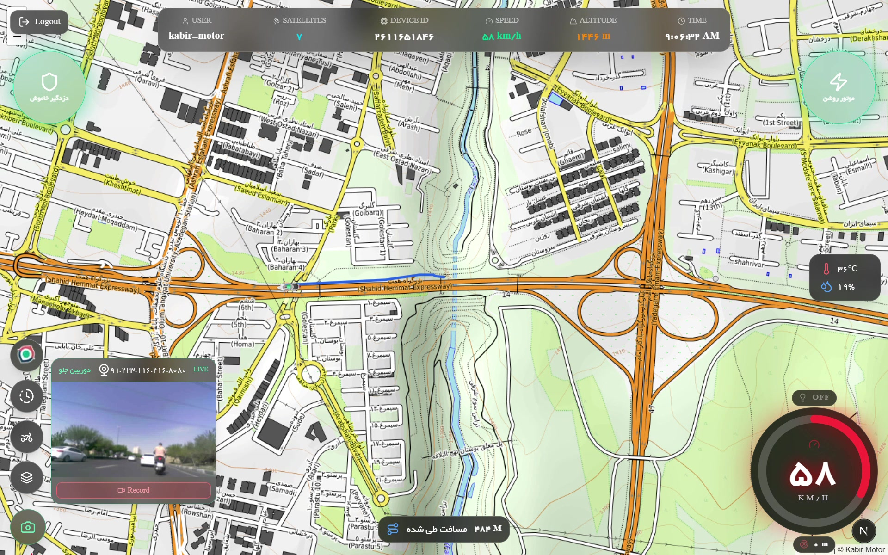
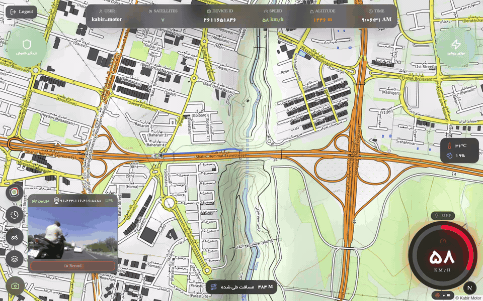
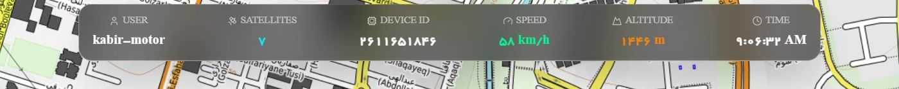
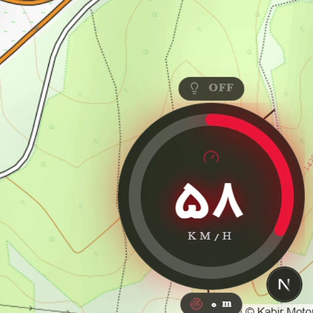
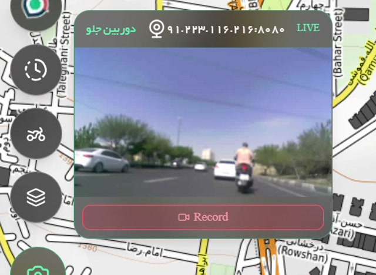
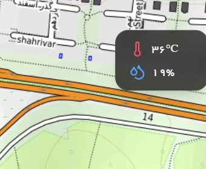
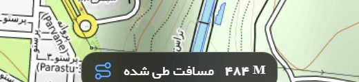
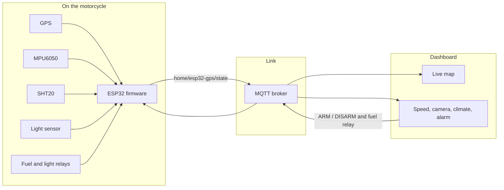

<p align="center">
  
  
  
  
</p>

<h1 align="center">Kabir Motor</h1>

<p align="center">
  ESP32 firmware for a connected motorcycle.<br>
  GPS, motion, climate, relays, and a setup portal feed the live dashboard.
</p>

<p align="center">
  <a href="https://github.com/omidram/kabir_motor"><b>Dashboard repo</b></a>
  &nbsp;·&nbsp;
  <a href="docs/ride.mp4"><b>Open the ride video</b></a>
</p>

<p align="center">
  
</p>

The frame above is a real ride. The ESP32 publishes speed, position, altitude, temperature, humidity, headlight state, and the trip distance. The [dashboard](https://github.com/omidram/kabir_motor) draws them on the map.

## The ride

Click the clip to open the full recording (`docs/ride.mp4`, about 8 seconds).

<p align="center">
  <a href="docs/ride.mp4">
    
  </a>
</p>

<p align="center">
  <a href="docs/ride.mp4"></a>
</p>

## What is on screen

<table>
  <tr>
    <td width="50%" align="center" valign="top">
      
      <br><b>Status bar</b>
      <br>User, satellite count, device id, speed, altitude, and clock. Speed and altitude come from the GPS sentence in the state message.
    </td>
    <td width="50%" align="center" valign="top">
      
      <br><b>Speedometer</b>
      <br>GPS speed in km/h. The pill above the dial is the headlight relay, driven by the light sensor on GPIO 34.
    </td>
  </tr>
  <tr>
    <td width="50%" align="center" valign="top">
      
      <br><b>Front camera</b>
      <br>Live view and record sit on the map. The firmware's job is the telemetry around that picture: position, speed, and alarms.
    </td>
    <td width="50%" align="center" valign="top">
      
      <br><b>Climate</b>
      <br>SHT20 temperature and humidity, plus the offsets saved in the setup portal, ride along in every publish.
    </td>
  </tr>
  <tr>
    <td colspan="2" align="center">
      
      <br><b>Trip distance</b>
      <br>The dashboard integrates the GPS track. This ride is still on the Hemmat interchange, 384 m in.
    </td>
  </tr>
</table>

## Two parts, one motorcycle



| | This repo | Dashboard |
| --- | --- | --- |
| What it is | ESP32 Arduino sketch | Next.js live map and controls |
| Where | `kabir_motor_main_final_MPU_full.ino` | [omidram/kabir_motor](https://github.com/omidram/kabir_motor) |
| Talks over | Wi-Fi and MQTT | The same broker, plus the camera stream |

## What the firmware does

- **Tracks the bike.** A GPS module on Serial1 (9600 baud, RX 16, TX 17) fills latitude, longitude, speed, satellites, and altitude.
- **Watches the chassis.** MPU6050 at I2C `0x68` measures pitch, roll, yaw, and acceleration. While the alarm is armed it looks for theft motion. While it is disarmed it looks for a crash or a fall.
- **Feels the air.** SHT20 temperature and humidity, with portal offsets, go out in the same JSON.
- **Switches power.** Fuel relay on GPIO 15. Headlight relay on GPIO 27, with an LDR on GPIO 34 so the lamp follows daylight.
- **Remembers the setup.** Wi-Fi, MQTT host and port, and sensor offsets live in Preferences. A 3 second press on GPIO 14 opens the `KabirMotor-<name>` access point and the setup page. A short press restarts the board.
- **Logs the ride.** When an SD card is present on chip-select GPIO 5, the sketch appends `gps.csv`, `mpu.csv`, `relay.csv`, `mqtt.csv`, and `system.csv`. The portal can download them.
- **Updates in place.** The portal has an OTA page, and ArduinoOTA runs once Wi-Fi is up.

Telemetry is published about every 2 seconds, retained, on `home/esp32-gps/state`:

```json
{
  "mpu": { "event": "normal", "pitch": "0.20", "roll": "-0.10", "yaw": "3.40", "ax": "0.012", "ay": "-0.004", "az": "0.998" },
  "gps": { "lat": 0.0, "lon": 0.0, "speed": 58.0, "sat": 7, "alt": 1246 },
  "relay": { "fuel": "ON", "light": "OFF" },
  "SHT20": { "temp": 35.0, "hum": 19.0 },
  "transport": "wifi",
  "uptime": "4m 12s",
  "code": "<device-code>",
  "wifi": -61
}
```

`mpu.event` is `normal`, `armed`, `theft_motion`, or `crash_or_fall`.

### Commands the dashboard can send

| Topic | Payload | Effect |
| --- | --- | --- |
| `relay/gr01/control` | `ON` or `OFF` | Fuel relay |
| `home/esp32-gps/mpu/cmd` | `{"COMMAND":"ARM"}` | Arm theft detection. Crash detection pauses. |
| `home/esp32-gps/mpu/cmd` | `{"COMMAND":"DISARM"}` | Disarm theft detection. Crash and fall detection resumes. |

Alarms go out on `home/esp32-gps/mpu/theft`, `home/esp32-gps/mpu/crash`, and `home/esp32-gps/mpu/state`.

Park the motorcycle level and still, then use **تنظیم موقعیت فعلی به عنوان صفر MPU** on the portal (or arm the alarm) so theft detection has a baseline. The baseline is stored in Preferences and survives reboot.

## Wiring

| Function | ESP32 pin |
| --- | --- |
| GPS RX | 16 |
| GPS TX | 17 |
| Fuel relay | 15 |
| Headlight relay | 27 |
| Setup button, input pull-up | 14 |
| Light sensor (LDR) | 34 |
| SD card chip select | 5 |
| MPU6050 and SHT20 | I2C, default SDA 21 / SCL 22. MPU address `0x68` |

## Flash it

Board package used for the local build: **esp32 by Espressif, core 3.3.7**, FQBN `esp32:esp32:esp32`, 240 MHz, 4 MB flash, 921600 upload.

Libraries the sketch includes:

- WiFiManager
- PubSubClient
- ArduinoJson
- TinyGPSPlus
- DFRobot SHT20
- A local `mpu6050` library with `wakeSensor`, `readAccelData`, `rawAccelToGForce`, `calculateAnglesFromAccel`, `calculateGyroOffset`, and `calculateAccelOffset`

Open `kabir_motor_main_final_MPU_full.ino` in the Arduino IDE and upload. Compiled binaries under `build/` stay on the machine that flashed the board. They are not part of this repository.

After the first boot, hold the setup button for 3 seconds, join the access point, and save the Wi-Fi network and the MQTT broker. The broker address is stored on the device. It is not hardcoded.
