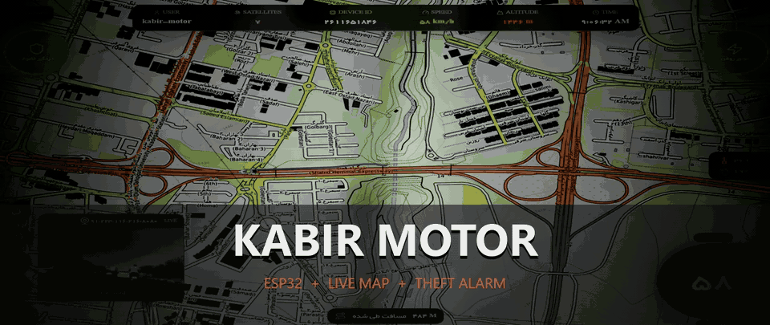
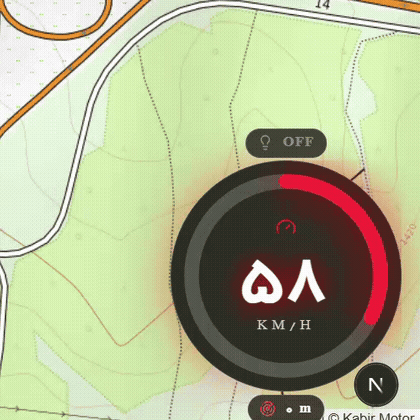
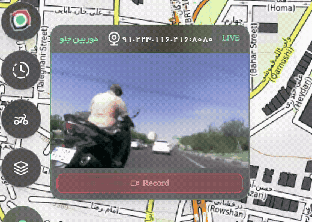
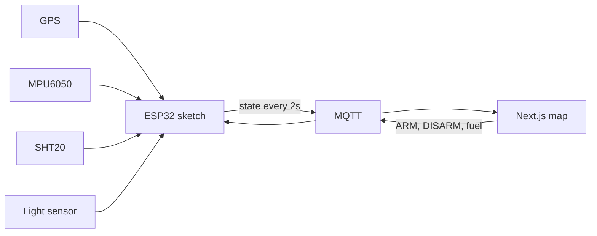

<p align="center">
  
</p>

<p align="center">
  <a href="docs/ride.mp4">
    
  </a>
</p>

<p align="center">
  
</p>

<p align="center">
  
  
  
  
</p>

<p align="center">
  
</p>

<p align="center">
  One motorcycle. Two halves of the same repository.<br>
  <b><a href="kabir_motor_main_final_MPU_full.ino">Firmware</a></b>
  on the bike, and the
  <b><a href="dashboard">dashboard</a></b>
  that draws the ride.<br>
  <a href="docs/ride.mp4"></a>
</p>

## The ride

The map, the dial, and the front camera are from one recording. Click either clip to open the video.

<p align="center">
  <a href="docs/ride.mp4">
    
  </a>
</p>

<table>
  <tr>
    <td width="42%" align="center" valign="middle">
      <a href="docs/ride.mp4"></a>
      <br><b>Speed</b>
      <br>The arc follows GPS speed. The pill above it is the headlight.
    </td>
    <td width="58%" align="center" valign="middle">
      <a href="docs/ride.mp4"></a>
      <br><b>Front camera</b>
      <br>Live view on the map, with record under the picture.
    </td>
  </tr>
</table>

<p align="center">
  
</p>

<table>
  <tr>
    <td width="50%" align="center">
      
      <br><b>Climate</b>
      <br>SHT20 temperature and humidity, with the offsets saved in the setup portal.
    </td>
    <td width="50%" align="center">
      
      <br><b>Distance</b>
      <br>The dashboard integrates the GPS track as the bike moves.
    </td>
  </tr>
</table>

## Garage

The dashboard ships a photo and a 3D model for each bike. These four are from the Kabir line, in `dashboard/public`.

<p align="center">
  
  
  
  
</p>

## How a packet becomes a picture



| On the bike | In this repo | On screen |
| --- | --- | --- |
| ESP32 sketch | `kabir_motor_main_final_MPU_full.ino` | — |
| Next.js app | `dashboard/` | Map, dial, camera, climate, alarm |
| Telemetry | `home/esp32-gps/state` | Status bar, speed, altitude |
| Theft alarm | `home/esp32-gps/mpu/cmd` | Shield button |
| Fuel relay | `relay/gr01/control` | Engine control |
| Camera stream | `dashboard/app/api/mjpeg` | Front camera card |

<details>
<summary><b>Telemetry JSON</b></summary>

<br>

Published about every 2 seconds, retained:

```json
{
  "mpu": { "event": "normal", "pitch": "0.20", "roll": "-0.10", "yaw": "3.40", "ax": "0.012", "ay": "-0.004", "az": "0.998" },
  "gps": { "lat": 0.0, "lon": 0.0, "speed": 58.0, "sat": 7, "alt": 1246 },
  "relay": { "fuel": "ON", "light": "OFF" },
  "SHT20": { "temp": 35.0, "hum": 19.0 },
  "transport": "wifi",
  "uptime": "4m 12s",
  "code": "<device-code>",
  "wifi": -61
}
```

`mpu.event` is `normal`, `armed`, `theft_motion`, or `crash_or_fall`.

</details>

<details>
<summary><b>Commands the dashboard sends</b></summary>

<br>

| Topic | Payload | Effect |
| --- | --- | --- |
| `relay/gr01/control` | `ON` or `OFF` | Fuel relay |
| `home/esp32-gps/mpu/cmd` | `{"COMMAND":"ARM"}` | Arm theft detection. Crash detection pauses. |
| `home/esp32-gps/mpu/cmd` | `{"COMMAND":"DISARM"}` | Disarm theft detection. Crash and fall detection resumes. |

Alarms publish on `home/esp32-gps/mpu/theft`, `home/esp32-gps/mpu/crash`, and `home/esp32-gps/mpu/state`.

Park the motorcycle level and still, then set the MPU zero from the setup portal so theft detection has a stored baseline.

</details>

<details>
<summary><b>Wiring</b></summary>

<br>

| Function | ESP32 pin |
| --- | --- |
| GPS RX | 16 |
| GPS TX | 17 |
| Fuel relay | 15 |
| Headlight relay | 27 |
| Setup button, input pull-up | 14 |
| Light sensor | 34 |
| SD card chip select | 5 |
| MPU6050 and SHT20 | I2C, default SDA 21 / SCL 22. MPU address `0x68` |

Hold the setup button for 3 seconds to open the `KabirMotor-<name>` access point. A short press restarts the board. Wi-Fi, the MQTT broker, and the SHT20 offsets are saved on the device from that page.

SD logs, when a card is present: `gps.csv`, `mpu.csv`, `relay.csv`, `mqtt.csv`, `system.csv`.

</details>

<details>
<summary><b>Run the dashboard</b></summary>

<br>

```bash
cd dashboard
npm install
npm run dev
```

Open `http://localhost:3000`.

`dashboard/docker-compose.yml` starts the published image on port 3000:

```bash
cd dashboard
docker compose up
```

</details>

<details>
<summary><b>Flash the firmware</b></summary>

<br>

Open `kabir_motor_main_final_MPU_full.ino` in the Arduino IDE.

Board package used for the local build: **esp32 by Espressif, core 3.3.7**, 240 MHz, 4 MB flash, 921600 upload.

Libraries the sketch includes:

- WiFiManager
- PubSubClient
- ArduinoJson
- TinyGPSPlus
- DFRobot SHT20
- A local `mpu6050` library with `wakeSensor`, `readAccelData`, `rawAccelToGForce`, `calculateAnglesFromAccel`, `calculateGyroOffset`, and `calculateAccelOffset`

Compiled files under `build/` stay on the machine that flashed the board.

</details>

<p align="center">
  
</p>
